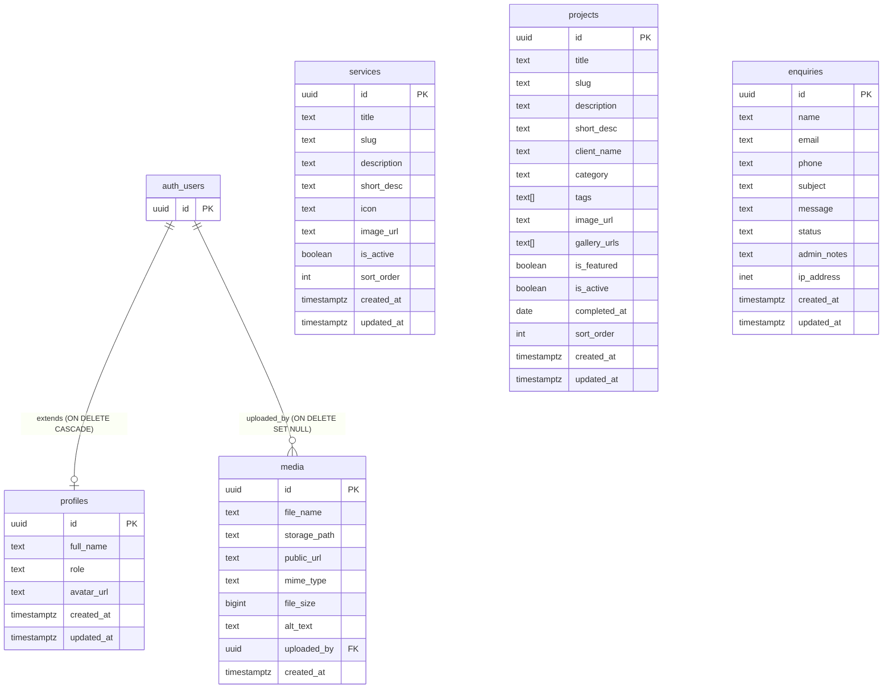

# Database Schema Reference

**Project:** Corporate Website + Admin Dashboard  
**Database:** PostgreSQL (Supabase managed)  
**Schema version:** Migration `003_security_hardening.sql` (rev 3 — final)  
**Migration history:** `001_initial_schema.sql` → `003_security_hardening.sql`

---

## Table of Contents

1. [Architecture Overview](#1-architecture-overview)
2. [Entity-Relationship Diagram](#2-entity-relationship-diagram)
3. [Tables](#3-tables)
   - [profiles](#31-profiles)
   - [services](#32-services)
   - [projects](#33-projects)
   - [enquiries](#34-enquiries)
   - [media](#35-media)
4. [Indexes](#4-indexes)
5. [Functions](#5-functions)
6. [Triggers](#6-triggers)
7. [Row Level Security Policies](#7-row-level-security-policies)
8. [Storage Bucket](#8-storage-bucket)
9. [Security and Access-Control Summary](#9-security-and-access-control-summary)
10. [Migration Notes](#10-migration-notes)

---

## 1. Architecture Overview

The database runs on **PostgreSQL** via Supabase and contains five application tables, all residing in the `public` schema. Supabase manages authentication in the separate `auth` schema; the application-level `profiles` table extends `auth.users` with role and display fields.

```
┌─────────────────────────────────────────────────────────────┐
│  Supabase / PostgreSQL                                      │
│                                                             │
│  auth schema (Supabase-managed)                             │
│  └── auth.users  ◄─────────────────────────────────┐       │
│                                                     │       │
│  public schema (application)                        │       │
│  ├── profiles  (FK → auth.users)  ──────────────────┘       │
│  ├── services                                               │
│  ├── projects                                               │
│  ├── enquiries                                              │
│  └── media     (FK → auth.users)                           │
│                                                             │
│  storage schema (Supabase-managed)                          │
│  └── storage.objects  (bucket: "media")                     │
└─────────────────────────────────────────────────────────────┘
```

**Key design decisions:**

- **No public registration.** Only the `admin` role exists in `profiles`. Accounts are created via the Supabase Dashboard (Authentication → Users → Invite User).
- **RLS on every table.** No table is accessible without an explicit policy.
- **Principle of least privilege.** Anonymous users can only read active public content and submit contact enquiries. All write operations on managed content require the `is_admin()` check.
- **No foreign keys between application tables.** `services`, `projects`, `enquiries`, and `media` are independent; only `profiles` and `media` reference `auth.users`.

---

## 2. Entity-Relationship Diagram

> [!NOTE]
> `profiles` and `media` are the only tables with foreign-key relationships (both point to `auth.users`). The remaining three tables (`services`, `projects`, `enquiries`) are standalone.



---

## 3. Tables

### 3.1 `profiles`

**Purpose:** Extends `auth.users` with application-level role and display information. Each row represents one admin account. Only the `admin` role value is accepted — no public sign-up path exists.

```sql
CREATE TABLE IF NOT EXISTS public.profiles (
  id          UUID        PRIMARY KEY REFERENCES auth.users(id) ON DELETE CASCADE,
  full_name   TEXT,
  role        TEXT        NOT NULL DEFAULT 'admin'
                          CHECK (role IN ('admin')),
  avatar_url  TEXT,
  created_at  TIMESTAMPTZ NOT NULL DEFAULT NOW(),
  updated_at  TIMESTAMPTZ NOT NULL DEFAULT NOW()
);
```

| Column | Type | Nullable | Default | Constraints |
|--------|------|----------|---------|-------------|
| `id` | `UUID` | NOT NULL | — | **PK**, FK → `auth.users(id)` ON DELETE CASCADE |
| `full_name` | `TEXT` | nullable | — | — |
| `role` | `TEXT` | NOT NULL | `'admin'` | CHECK `role IN ('admin')` |
| `avatar_url` | `TEXT` | nullable | — | — |
| `created_at` | `TIMESTAMPTZ` | NOT NULL | `NOW()` | — |
| `updated_at` | `TIMESTAMPTZ` | NOT NULL | `NOW()` | Auto-updated by trigger |

> [!IMPORTANT]
> The `role` column is protected by a `BEFORE UPDATE` trigger (`trg_prevent_role_change`) that prevents any application-level UPDATE from changing the role value. Only a database superuser operating outside the trigger context can alter a role.

---

### 3.2 `services`

**Purpose:** Stores the company's service offerings, managed exclusively by administrators. Active services are displayed on the public Services page.

```sql
CREATE TABLE IF NOT EXISTS public.services (
  id          UUID        PRIMARY KEY DEFAULT gen_random_uuid(),
  title       TEXT        NOT NULL,
  slug        TEXT        NOT NULL UNIQUE,
  description TEXT        NOT NULL,
  short_desc  TEXT,
  icon        TEXT,
  image_url   TEXT,
  is_active   BOOLEAN     NOT NULL DEFAULT TRUE,
  sort_order  INT         NOT NULL DEFAULT 0,
  created_at  TIMESTAMPTZ NOT NULL DEFAULT NOW(),
  updated_at  TIMESTAMPTZ NOT NULL DEFAULT NOW()
);
```

| Column | Type | Nullable | Default | Constraints |
|--------|------|----------|---------|-------------|
| `id` | `UUID` | NOT NULL | `gen_random_uuid()` | **PK** |
| `title` | `TEXT` | NOT NULL | — | — |
| `slug` | `TEXT` | NOT NULL | — | UNIQUE |
| `description` | `TEXT` | NOT NULL | — | — |
| `short_desc` | `TEXT` | nullable | — | — |
| `icon` | `TEXT` | nullable | — | Lucide icon name, e.g. `"code"` |
| `image_url` | `TEXT` | nullable | — | Supabase Storage public URL |
| `is_active` | `BOOLEAN` | NOT NULL | `TRUE` | Controls public visibility |
| `sort_order` | `INT` | NOT NULL | `0` | Display ordering |
| `created_at` | `TIMESTAMPTZ` | NOT NULL | `NOW()` | — |
| `updated_at` | `TIMESTAMPTZ` | NOT NULL | `NOW()` | Auto-updated by trigger |

---

### 3.3 `projects`

**Purpose:** Portfolio projects displayed on the public Projects page and optionally on the Home page. Admin-managed with full CRUD.

```sql
CREATE TABLE IF NOT EXISTS public.projects (
  id            UUID        PRIMARY KEY DEFAULT gen_random_uuid(),
  title         TEXT        NOT NULL,
  slug          TEXT        NOT NULL UNIQUE,
  description   TEXT        NOT NULL,
  short_desc    TEXT,
  client_name   TEXT,
  category      TEXT,
  tags          TEXT[]      NOT NULL DEFAULT '{}',
  image_url     TEXT,
  gallery_urls  TEXT[]      NOT NULL DEFAULT '{}',
  is_featured   BOOLEAN     NOT NULL DEFAULT FALSE,
  is_active     BOOLEAN     NOT NULL DEFAULT TRUE,
  completed_at  DATE,
  sort_order    INT         NOT NULL DEFAULT 0,
  created_at    TIMESTAMPTZ NOT NULL DEFAULT NOW(),
  updated_at    TIMESTAMPTZ NOT NULL DEFAULT NOW()
);
```

| Column | Type | Nullable | Default | Constraints |
|--------|------|----------|---------|-------------|
| `id` | `UUID` | NOT NULL | `gen_random_uuid()` | **PK** |
| `title` | `TEXT` | NOT NULL | — | — |
| `slug` | `TEXT` | NOT NULL | — | UNIQUE |
| `description` | `TEXT` | NOT NULL | — | — |
| `short_desc` | `TEXT` | nullable | — | — |
| `client_name` | `TEXT` | nullable | — | — |
| `category` | `TEXT` | nullable | — | — |
| `tags` | `TEXT[]` | NOT NULL | `'{}'` | Array, e.g. `'{"React","Node.js"}'` |
| `image_url` | `TEXT` | nullable | — | Primary/hero image |
| `gallery_urls` | `TEXT[]` | NOT NULL | `'{}'` | Additional image URLs |
| `is_featured` | `BOOLEAN` | NOT NULL | `FALSE` | Shows on Home page highlights |
| `is_active` | `BOOLEAN` | NOT NULL | `TRUE` | Controls public visibility |
| `completed_at` | `DATE` | nullable | — | Project completion date |
| `sort_order` | `INT` | NOT NULL | `0` | Display ordering |
| `created_at` | `TIMESTAMPTZ` | NOT NULL | `NOW()` | — |
| `updated_at` | `TIMESTAMPTZ` | NOT NULL | `NOW()` | Auto-updated by trigger |

---

### 3.4 `enquiries`

**Purpose:** Contact form submissions from public visitors. Anonymous users may INSERT; only admins may read, update, or delete. Enquiry data is treated as private PII.

```sql
CREATE TABLE IF NOT EXISTS public.enquiries (
  id           UUID        PRIMARY KEY DEFAULT gen_random_uuid(),
  name         TEXT        NOT NULL CHECK (char_length(name)    BETWEEN 2 AND 100),
  email        TEXT        NOT NULL CHECK (email ~* '^[^@]+@[^@]+\.[^@]+$'),
  phone        TEXT        CHECK (phone IS NULL OR char_length(phone) <= 20),
  subject      TEXT        CHECK (subject IS NULL OR char_length(subject) <= 200),
  message      TEXT        NOT NULL CHECK (char_length(message) BETWEEN 10 AND 5000),
  status       TEXT        NOT NULL DEFAULT 'new'
                           CHECK (status IN ('new', 'read', 'replied', 'closed')),
  admin_notes  TEXT,
  ip_address   INET,
  created_at   TIMESTAMPTZ NOT NULL DEFAULT NOW(),
  updated_at   TIMESTAMPTZ NOT NULL DEFAULT NOW()
);
```

| Column | Type | Nullable | Default | Constraints |
|--------|------|----------|---------|-------------|
| `id` | `UUID` | NOT NULL | `gen_random_uuid()` | **PK** |
| `name` | `TEXT` | NOT NULL | — | CHECK length BETWEEN 2 AND 100 |
| `email` | `TEXT` | NOT NULL | — | CHECK regex `'^[^@]+@[^@]+\.[^@]+$'` |
| `phone` | `TEXT` | nullable | — | CHECK length ≤ 20 when not NULL |
| `subject` | `TEXT` | nullable | — | CHECK length ≤ 200 when not NULL |
| `message` | `TEXT` | NOT NULL | — | CHECK length BETWEEN 10 AND 5000 |
| `status` | `TEXT` | NOT NULL | `'new'` | CHECK `IN ('new','read','replied','closed')` |
| `admin_notes` | `TEXT` | nullable | — | Internal admin-only notes |
| `ip_address` | `INET` | nullable | — | Optional; for spam control, not set by frontend |
| `created_at` | `TIMESTAMPTZ` | NOT NULL | `NOW()` | — |
| `updated_at` | `TIMESTAMPTZ` | NOT NULL | `NOW()` | Auto-updated by trigger |

**Enquiry status workflow:**

```
new  →  read  →  replied  →  closed
```

---

### 3.5 `media`

**Purpose:** Registry of images uploaded to the Supabase Storage `media` bucket. Tracks metadata and links each file to the authenticated user who uploaded it.

```sql
CREATE TABLE IF NOT EXISTS public.media (
  id            UUID        PRIMARY KEY DEFAULT gen_random_uuid(),
  file_name     TEXT        NOT NULL,
  storage_path  TEXT        NOT NULL UNIQUE,
  public_url    TEXT        NOT NULL,
  mime_type     TEXT        NOT NULL CHECK (mime_type IN (
                              'image/jpeg', 'image/png', 'image/webp',
                              'image/gif',  'image/svg+xml'
                            )),
  file_size     BIGINT      CHECK (file_size > 0 AND file_size <= 10485760),
  alt_text      TEXT,
  uploaded_by   UUID        REFERENCES auth.users(id) ON DELETE SET NULL,
  created_at    TIMESTAMPTZ NOT NULL DEFAULT NOW()
);
```

| Column | Type | Nullable | Default | Constraints |
|--------|------|----------|---------|-------------|
| `id` | `UUID` | NOT NULL | `gen_random_uuid()` | **PK** |
| `file_name` | `TEXT` | NOT NULL | — | Original filename |
| `storage_path` | `TEXT` | NOT NULL | — | UNIQUE; path within the `media` bucket |
| `public_url` | `TEXT` | NOT NULL | — | Full publicly accessible URL |
| `mime_type` | `TEXT` | NOT NULL | — | CHECK `IN ('image/jpeg','image/png','image/webp','image/gif','image/svg+xml')` |
| `file_size` | `BIGINT` | nullable | — | CHECK `> 0 AND <= 10485760` (10 MB max) |
| `alt_text` | `TEXT` | nullable | — | Accessibility description |
| `uploaded_by` | `UUID` | nullable | — | FK → `auth.users(id)` ON DELETE SET NULL |
| `created_at` | `TIMESTAMPTZ` | NOT NULL | `NOW()` | — |

> [!NOTE]
> `media` has no `updated_at` column and therefore no `set_updated_at` trigger. The `updated_at` trigger chain covers only `profiles`, `services`, `projects`, and `enquiries`.

---

## 4. Indexes

All indexes are created with `CREATE INDEX IF NOT EXISTS` and are non-unique unless noted.

### `services`

| Index name | Column(s) | Purpose |
|-----------|-----------|---------|
| `idx_services_is_active` | `is_active` | Filter active services for public page |
| `idx_services_sort_order` | `sort_order` | Ordered listing |
| `idx_services_slug` | `slug` | Slug lookups (also backed by UNIQUE constraint) |

### `projects`

| Index name | Column(s) | Purpose |
|-----------|-----------|---------|
| `idx_projects_is_active` | `is_active` | Filter active projects for public page |
| `idx_projects_is_featured` | `is_featured` | Filter featured projects for Home page |
| `idx_projects_category` | `category` | Category filtering |
| `idx_projects_slug` | `slug` | Slug lookups (also backed by UNIQUE constraint) |
| `idx_projects_sort_order` | `sort_order` | Ordered listing |

### `enquiries`

| Index name | Column(s) | Purpose |
|-----------|-----------|---------|
| `idx_enquiries_status` | `status` | Filter by workflow status |
| `idx_enquiries_created_at` | `created_at DESC` | Chronological listing (newest first) |

### `media`

| Index name | Column(s) | Purpose |
|-----------|-----------|---------|
| `idx_media_uploaded_by` | `uploaded_by` | Filter media by uploader |
| `idx_media_mime_type` | `mime_type` | Filter by file type |

---

## 5. Functions

### 5.1 `public.is_admin()`

```sql
CREATE OR REPLACE FUNCTION public.is_admin()
RETURNS BOOLEAN
LANGUAGE sql
STABLE
SECURITY INVOKER
SET search_path = public, pg_catalog
AS $$
  SELECT EXISTS (
    SELECT 1
    FROM   public.profiles
    WHERE  id   = auth.uid()
    AND    role = 'admin'
  );
$$;
```

| Property | Value |
|----------|-------|
| **Returns** | `BOOLEAN` — `TRUE` if the caller is an admin, `FALSE` otherwise |
| **Language** | `sql` |
| **Security** | `SECURITY INVOKER` — executes with the calling user's privileges |
| **Volatility** | `STABLE` — PostgreSQL may cache the result within a single statement |
| **search_path** | `public, pg_catalog` — prevents search-path injection (CWE-427 defence) |
| **Execute grant** | `authenticated` only |
| **Revoked from** | `PUBLIC`, `anon` |

**How it works:** Queries `public.profiles` to check whether `auth.uid()` (the JWT-authenticated caller's UUID) matches a row with `role = 'admin'`. Used as the security gate in every write-side RLS policy (migration 003).

---

### 5.2 `public.get_dashboard_stats()`

```sql
CREATE OR REPLACE FUNCTION public.get_dashboard_stats()
RETURNS JSON
LANGUAGE plpgsql
SECURITY DEFINER
SET search_path = public, pg_catalog
AS $$
BEGIN
  IF NOT public.is_admin() THEN
    RAISE EXCEPTION
      'Access denied: get_dashboard_stats() requires admin role'
      USING ERRCODE = 'insufficient_privilege';
  END IF;

  RETURN json_build_object(
    'total_projects',    (SELECT COUNT(*) FROM public.projects),
    'active_projects',   (SELECT COUNT(*) FROM public.projects  WHERE is_active   = TRUE),
    'featured_projects', (SELECT COUNT(*) FROM public.projects  WHERE is_featured = TRUE),
    'total_services',    (SELECT COUNT(*) FROM public.services),
    'active_services',   (SELECT COUNT(*) FROM public.services  WHERE is_active   = TRUE),
    'total_enquiries',   (SELECT COUNT(*) FROM public.enquiries),
    'new_enquiries',     (SELECT COUNT(*) FROM public.enquiries WHERE status      = 'new'),
    'total_media',       (SELECT COUNT(*) FROM public.media)
  );
END;
$$;
```

| Property | Value |
|----------|-------|
| **Returns** | `JSON` object with 8 aggregate counts |
| **Language** | `plpgsql` |
| **Security** | `SECURITY DEFINER` — bypasses RLS to count all rows including inactive/draft |
| **search_path** | `public, pg_catalog` — CWE-427 defence |
| **Body guard** | `is_admin()` check raises `insufficient_privilege` (SQLSTATE `42501`) for any non-admin caller |
| **Execute grant** | `authenticated` only |
| **Revoked from** | `PUBLIC`, `anon` |

**JSON response shape:**

```json
{
  "total_projects":    <integer>,
  "active_projects":   <integer>,
  "featured_projects": <integer>,
  "total_services":    <integer>,
  "active_services":   <integer>,
  "total_enquiries":   <integer>,
  "new_enquiries":     <integer>,
  "total_media":       <integer>
}
```

> [!IMPORTANT]
> `SECURITY DEFINER` is intentional here — it allows the function to count ALL rows (including inactive/draft records) which the admin dashboard requires. The `is_admin()` body guard is the authoritative access control; the `GRANT TO authenticated` is a secondary scope limiter only.

---

### 5.3 `public.set_updated_at()`

```sql
CREATE OR REPLACE FUNCTION public.set_updated_at()
RETURNS TRIGGER
LANGUAGE plpgsql
SECURITY INVOKER
SET search_path = public, pg_catalog
AS $$
BEGIN
  NEW.updated_at = NOW();
  RETURN NEW;
END;
$$;
```

| Property | Value |
|----------|-------|
| **Returns** | `TRIGGER` |
| **Language** | `plpgsql` |
| **Security** | `SECURITY INVOKER` |
| **search_path** | `public, pg_catalog` |
| **Purpose** | Automatically sets `updated_at = NOW()` before every UPDATE |

---

### 5.4 `public.prevent_role_change()`

```sql
CREATE OR REPLACE FUNCTION public.prevent_role_change()
RETURNS TRIGGER
LANGUAGE plpgsql
SECURITY INVOKER
SET search_path = public, pg_catalog
AS $$
BEGIN
  IF NEW.role IS DISTINCT FROM OLD.role THEN
    RAISE EXCEPTION
      'Permission denied: the role column cannot be changed after a profile '
      'is created. Contact a database administrator to modify user roles.'
      USING ERRCODE = 'check_violation';   -- SQLSTATE 23514
  END IF;
  RETURN NEW;
END;
$$;
```

| Property | Value |
|----------|-------|
| **Returns** | `TRIGGER` |
| **Language** | `plpgsql` |
| **Security** | `SECURITY INVOKER` |
| **search_path** | `public, pg_catalog` |
| **Purpose** | Blocks any UPDATE that attempts to change the `role` column |
| **Comparison operator** | `IS DISTINCT FROM` — correctly handles `NULL` values, unlike `<>` |
| **Error raised** | `check_violation` (SQLSTATE `23514`) |

**Why a trigger instead of an RLS `WITH CHECK` sub-query:**

| Risk | RLS WITH CHECK | Trigger |
|------|----------------|---------|
| NULL edge case — sub-query returns NULL if profile not found, silently blocking legitimate updates to `full_name`/`avatar_url` | ❌ Vulnerable | ✅ Direct `OLD`/`NEW` access, no sub-query |
| SECURITY DEFINER bypass — elevated functions skip RLS | ❌ Bypassed | ✅ Triggers fire on every UPDATE path regardless of privilege level |
| Future code surfaces | ❌ Must be manually checked per path | ✅ Automatically protected |

---

## 6. Triggers

### `updated_at` triggers

| Trigger name | Table | Event | Timing | Orientation | Function |
|-------------|-------|-------|--------|-------------|----------|
| `trg_profiles_updated_at` | `profiles` | UPDATE | BEFORE | ROW | `set_updated_at()` |
| `trg_services_updated_at` | `services` | UPDATE | BEFORE | ROW | `set_updated_at()` |
| `trg_projects_updated_at` | `projects` | UPDATE | BEFORE | ROW | `set_updated_at()` |
| `trg_enquiries_updated_at` | `enquiries` | UPDATE | BEFORE | ROW | `set_updated_at()` |

> [!NOTE]
> `media` has no `updated_at` column and therefore no `set_updated_at` trigger.

### Role-protection trigger

| Trigger name | Table | Event | Timing | Orientation | Function |
|-------------|-------|-------|--------|-------------|----------|
| `trg_prevent_role_change` | `profiles` | UPDATE | BEFORE | ROW | `prevent_role_change()` |

**Execution order on a `profiles` UPDATE:**

```
UPDATE profiles SET ... WHERE id = ...
         │
         ▼
  BEFORE UPDATE triggers fire (row level)
  ├── trg_prevent_role_change  → aborts if role column changes
  └── trg_profiles_updated_at → sets updated_at = NOW()
         │
         ▼
  Row is written to disk (only if both triggers pass)
```

---

## 7. Row Level Security Policies

RLS is **enabled on all five tables**. No table access is possible without an explicit matching policy.

> [!IMPORTANT]
> After migration 003, all write-side policies require `public.is_admin()`. The original migration 001 policies used `WITH CHECK (TRUE)` which allowed any authenticated Supabase user to write — these were replaced.

### 7.1 `profiles`

| Policy name | Operation | Role | USING | WITH CHECK |
|-------------|-----------|------|-------|------------|
| `profiles: admin can read own profile` | SELECT | `authenticated` | `auth.uid() = id` | — |
| `profiles: admin can update own profile` | UPDATE | `authenticated` | `auth.uid() = id` | `auth.uid() = id` |

- No INSERT policy — profile rows are created by manual database seeding or a Supabase Auth trigger.
- No DELETE policy — profile deletion is not exposed to the application.
- No `anon` access of any kind.

---

### 7.2 `services`

| Policy name | Operation | Role | USING | WITH CHECK |
|-------------|-----------|------|-------|------------|
| `services: public can read active` | SELECT | `anon` | `is_active = TRUE` | — |
| `services: admin full read` | SELECT | `authenticated` | `is_admin()` | — |
| `services: admin can insert` | INSERT | `authenticated` | — | `is_admin()` |
| `services: admin can update` | UPDATE | `authenticated` | `is_admin()` | `is_admin()` |
| `services: admin can delete` | DELETE | `authenticated` | `is_admin()` | — |

---

### 7.3 `projects`

| Policy name | Operation | Role | USING | WITH CHECK |
|-------------|-----------|------|-------|------------|
| `projects: public can read active` | SELECT | `anon` | `is_active = TRUE` | — |
| `projects: admin full read` | SELECT | `authenticated` | `is_admin()` | — |
| `projects: admin can insert` | INSERT | `authenticated` | — | `is_admin()` |
| `projects: admin can update` | UPDATE | `authenticated` | `is_admin()` | `is_admin()` |
| `projects: admin can delete` | DELETE | `authenticated` | `is_admin()` | — |

---

### 7.4 `enquiries`

| Policy name | Operation | Role | USING | WITH CHECK |
|-------------|-----------|------|-------|------------|
| `enquiries: public can insert` | INSERT | `anon` | — | `char_length(name) BETWEEN 2 AND 100 AND email ~* '^[^@]+@[^@]+\.[^@]+$' AND char_length(message) BETWEEN 10 AND 5000` |
| `enquiries: admin full read` | SELECT | `authenticated` | `is_admin()` | — |
| `enquiries: admin can update` | UPDATE | `authenticated` | `is_admin()` | `is_admin()` |
| `enquiries: admin can delete` | DELETE | `authenticated` | `is_admin()` | — |

> [!IMPORTANT]
> There is intentionally **no SELECT policy for `anon`** on enquiries. Visitor PII submitted via the contact form is never readable by anonymous users.

---

### 7.5 `media`

| Policy name | Operation | Role | USING | WITH CHECK |
|-------------|-----------|------|-------|------------|
| `media: public can read` | SELECT | `anon` | `TRUE` | — |
| `media: admin full read` | SELECT | `authenticated` | `is_admin()` | — |
| `media: admin can insert` | INSERT | `authenticated` | — | `is_admin() AND auth.uid() = uploaded_by` |
| `media: admin can update` | UPDATE | `authenticated` | `is_admin()` | `is_admin()` |
| `media: admin can delete` | DELETE | `authenticated` | `is_admin()` | — |

> [!NOTE]
> The INSERT policy enforces two conditions: the caller must be an admin **and** `uploaded_by` must equal `auth.uid()`, ensuring every registry row is correctly attributed to its uploader.
>
> The `media: admin can update` policy was **not present in migration 001** — it was added by migration 003 to allow admins to edit metadata fields (`alt_text`, `file_name`).

---

## 8. Storage Bucket

### Bucket: `media`

| Property | Value |
|----------|-------|
| **Bucket ID** | `media` |
| **Name** | `media` |
| **Public** | `TRUE` — files are served via public URLs without authentication |
| **File size limit** | `10,485,760` bytes (10 MB) |
| **Allowed MIME types** | `image/jpeg`, `image/png`, `image/webp`, `image/gif`, `image/svg+xml` |
| **Created by** | `001_initial_schema.sql` with `ON CONFLICT (id) DO NOTHING` (idempotent) |

### Storage RLS policies (`storage.objects`)

| Policy name | Operation | Role | Condition |
|-------------|-----------|------|-----------|
| `storage media: public read` | SELECT | `anon` | `bucket_id = 'media'` |
| `storage media: admin can upload` | INSERT | `authenticated` | `bucket_id = 'media' AND is_admin()` |
| `storage media: admin can update` | UPDATE | `authenticated` | `bucket_id = 'media' AND is_admin()` |
| `storage media: admin can delete` | DELETE | `authenticated` | `bucket_id = 'media' AND is_admin()` |

> [!NOTE]
> The UPDATE policy on `storage.objects` handles **file overwrites** — Supabase Storage maps an overwrite operation to an UPDATE on the `storage.objects` table. This policy did not exist in migration 001 and was added by migration 003.

---

## 9. Security and Access-Control Summary

### Role matrix

| Table / Resource | `anon` SELECT | `anon` INSERT | `authenticated` (non-admin) | `authenticated` (admin) |
|-----------------|:---:|:---:|:---:|:---:|
| `profiles` | ✗ | ✗ | Own row only | Own row only |
| `services` | Active only | ✗ | ✗ | Full CRUD |
| `projects` | Active only | ✗ | ✗ | Full CRUD |
| `enquiries` | ✗ | ✓ (validated) | ✗ | Full CRUD |
| `media` (table) | ✓ | ✗ | ✗ | Full CRUD |
| `storage/media` (files) | ✓ | ✗ | ✗ | Upload / Update / Delete |
| `get_dashboard_stats()` | ✗ | — | ✗ (body guard) | ✓ |
| `is_admin()` | ✗ | — | ✓ (called) | ✓ |

> [!NOTE]
> "authenticated (non-admin)" means a user who holds a valid Supabase Auth JWT but has no row in `public.profiles` with `role = 'admin'`. Every write policy calls `is_admin()` before granting access, so a valid JWT alone is insufficient.

### Defence-in-depth layers

```
Request
   │
   ▼
1. Supabase Auth JWT validation (auth schema)
   │
   ▼
2. PostgREST role assignment (anon / authenticated)
   │
   ▼
3. RLS USING clause — row visibility filter
   │
   ▼
4. is_admin() check — admin identity verification
   │
   ▼
5. RLS WITH CHECK clause — write value validation
   │
   ▼
6. CHECK constraints — data integrity at column level
   │
   ▼
7. Trigger (profiles only) — role-change prevention
   │
   ▼
   Row written / returned
```

### Function permission summary

| Function | Language | Security | search_path | PUBLIC grant | anon grant | authenticated grant |
|----------|----------|----------|-------------|:---:|:---:|:---:|
| `is_admin()` | `sql` | INVOKER | ✓ | REVOKED | REVOKED | GRANTED |
| `get_dashboard_stats()` | `plpgsql` | DEFINER | ✓ | REVOKED | REVOKED | GRANTED |
| `set_updated_at()` | `plpgsql` | INVOKER | ✓ | — | — | — |
| `prevent_role_change()` | `plpgsql` | INVOKER | ✓ | — | — | — |

### Key security properties

- **No service-role key in the frontend.** The application uses only the Supabase `anon` key with RLS enforcing access.
- **No public registration.** `profiles.role` has a `CHECK (role IN ('admin'))` constraint — only the admin role is valid.
- **Role self-promotion blocked.** The `trg_prevent_role_change` trigger fires on every UPDATE path (including SECURITY DEFINER functions) and raises SQLSTATE `23514` if `OLD.role IS DISTINCT FROM NEW.role`.
- **CWE-427 mitigation.** All four functions set `search_path = public, pg_catalog` to prevent schema search-path injection attacks.
- **Enquiry PII protection.** No SELECT policy exists for `anon` on the `enquiries` table.
- **Storage MIME and size enforcement.** Restricted to five image MIME types and 10 MB maximum, enforced at both the bucket level and the `media` table CHECK constraint.

---

## 10. Migration Notes

| Migration | Status | Description |
|-----------|--------|-------------|
| `001_initial_schema.sql` | ✅ **Executed in production** | Tables, indexes, triggers, initial RLS policies, storage bucket, `get_dashboard_stats()` |
| `002_security_fixes.sql` | ⚠️ **Superseded** | Intermediate fix — superseded by 003; run 001 → 003, skip 002 |
| `003_security_hardening.sql` | 🔲 **Not yet executed** | Adds `is_admin()`, hardens all write policies, adds `prevent_role_change` trigger, adds safe `search_path` to all functions |

> [!CAUTION]
> Do **not** run migration 002 if 003 has already been applied, and do **not** run 002 before 003. Migration 003 is designed to be safe regardless of whether 002 was previously executed (all DROPs use `IF EXISTS`).

### How to apply migration 003

1. Open **Supabase Dashboard → SQL Editor → New Query**
2. Paste the entire contents of `supabase/migrations/003_security_hardening.sql`
3. Click **Run**
4. Verify using the commented verification queries at the bottom of the file

### Post-migration: create the first admin user

After running migration 003, create an admin account:

1. **Supabase Dashboard → Authentication → Users → Add User**
2. Enter email and password
3. Copy the generated UUID
4. Run in SQL Editor:

```sql
INSERT INTO public.profiles (id, full_name, role)
VALUES ('<uuid-from-auth.users>', 'Admin Name', 'admin');
```

---

*Documentation sourced exclusively from `supabase/migrations/001_initial_schema.sql` and `supabase/migrations/003_security_hardening.sql`. Last updated: 2026-11-18.*
